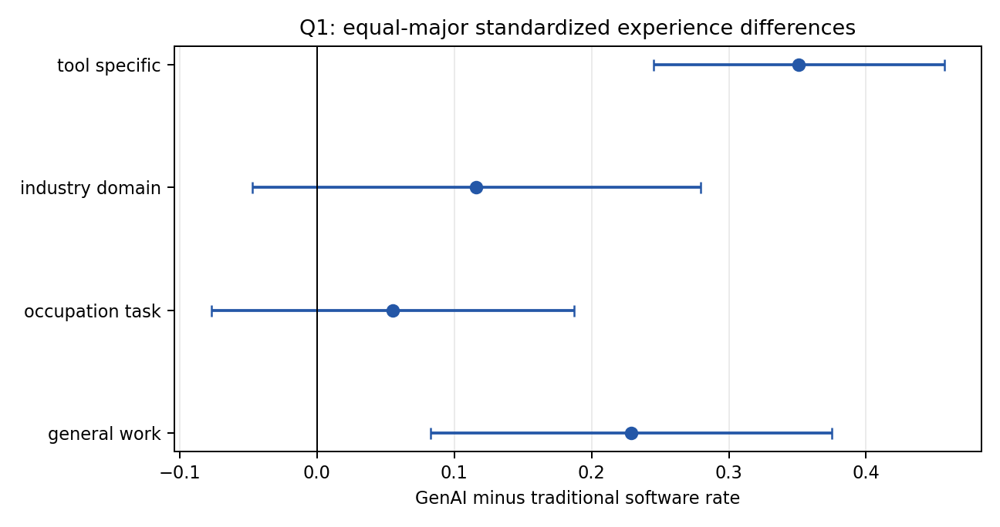
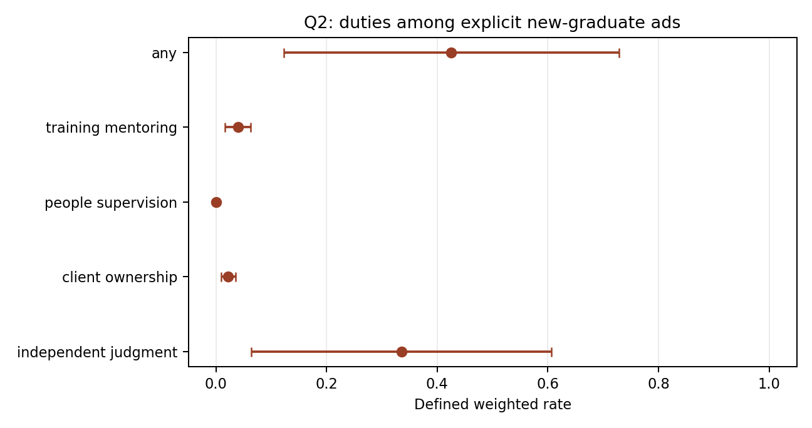
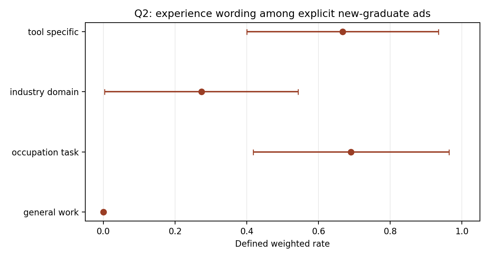

# 冻结 Formal800 的两项补充比较：结果备忘录

本备忘录复用已冻结的 Formal800 标签、抽样设计和第三阶段权重（`w3=1/pi3`），不新增文本提取、广告审阅、抽样或模型推断。推断对象是已实现固定 10k 样本中的 9,282 条合格广告；实际分析样本为 800 条广告、719 份结构化正文审阅。结果来自 SCNet 调度作业 46700531（完成，退出码 0）。以下区间仅反映在冻结语义分类和既定支持集条件下的抽样不确定性；不包括语义标签误差、支持集选择或技术组成员资格不确定性。

## Q1：在相同大类职业构成下，GenAI 使用与传统软件使用广告的经验措辞

比较组沿用冻结定义：GenAI 使用组可同时出现传统软件；对照组为传统软件使用且没有活动 AI 使用。分析只使用事先确定的共同支持职业大类 11、13、15、17。对每一大类和技术组，以 `w3` 在已知结果中计算经验正例比例，再对四个大类各赋 25% 权重。这个标准化回答的是：两组若有相同的**宽职业大类**构成，经验措辞差异会怎样；它不匹配企业、细分职业、岗位层级或日期，也不是固定效应或因果估计。

| 经验维度 | 原始共同支持范围：GenAI − 软件（百分点） | 等权职业大类标准化：GenAI − 软件（百分点，95% 设计区间） | 解读 |
| --- | ---: | ---: | --- |
| 一般工作经验 | +15.6 | **+22.9 [8.3, 37.5]** | 标准化后仍为正 |
| 职业／任务经验 | +5.4 | +5.5 [-7.7, 18.7] | 区间包含零 |
| 行业／领域经验 | +10.9 | +11.6 [-4.7, 27.9] | 区间包含零 |
| 工具特定经验 | +22.9 | **+35.1 [24.5, 45.7]** | 标准化后差异较大且为正 |

等权后，GenAI 组的一般工作经验率为 35.3%，传统软件组为 12.4%；工具特定经验分别为 91.5% 和 56.4%。职业／任务经验（89.3% 对 83.8%）和行业／领域经验（70.4% 对 58.7%）的点差为正，但设计区间均包含零。未标准化的共同支持总体结果也列于表中，用于显示组成敏感性；这些旧的池化估计经原表逐行核验后原样保留，并非本次标准化的替代品。

每一比例以该组该结果的已知标签为分母；记录为未知的经验标签不被当作零，同时按同一固定权重给出未知值上下界。若任一必需的大类—技术组没有已知分母，标准化估计不作重新归一化，而报告为不可得。

[图1 PDF](results/FIG1_Q1_EQUAL_MAJOR.pdf) · [完整标准化表](results/Q1_EQUAL_MAJOR_STANDARDIZED.csv) · [按大类与原始共同支持表](results/Q1_WITHIN_MAJOR_AND_POOLED.csv)

## Q2：明确欢迎毕业生的措辞、当前职责与经验措辞是否共现

主分析包括所有技术类别中明确标为欢迎毕业生的广告（冻结样本为 33 条），而不是只保留可进入 Q1 的技术组。表中的职责只计“当前被招聘者”承担的严格职责；每项使用已知职责标签为分母，并报告未知数、权重合计、设计区间和未知标签上下界。资格措辞本身未知的广告不进入该分母，另行报告其未加权数量和权重合计。经验共现同时报告四个冻结经验维度及其可识别组合。

| 结果 | 已知／未知广告数 | 明确毕业生措辞下的加权比例（95% 设计区间） |
| --- | ---: | --- |
| 独立判断／审核验证 | 31／2 | 33.5% [6.4, 60.6] |
| 客户责任 | 32／1 | 2.2% [0.9, 3.5] |
| 人员监督 | 33／0 | 0.0% [0.0, 0.0]* |
| 培训／指导他人 | 30／3 | 4.0% [1.7, 6.3] |
| 至少一种严格当前职责 | 28／5 | 42.6% [12.3, 72.9] |
| 一般工作经验共现 | 30／3 | 0.0% [0.0, 0.0]* |
| 职业／任务经验共现 | 30／3 | 69.1% [41.8, 96.4] |
| 行业／领域经验共现 | 32／1 | 27.3% [0.4, 54.3] |
| 工具特定经验共现 | 32／1 | 66.8% [40.0, 93.5] |

明确毕业生措辞的权重合计为 103.6；另有 1 条广告（权重合计 11.8）的毕业生资格标签未知，未进入该域。*人员监督和一般工作经验均为零检出、线性化标准误退化；这不是总体比例为零的证据。职责未知界限、经验未知界限和明确毕业生的无条件措辞敏感性均在附表中报告。

若职责或经验措辞与明确毕业生表述同时出现，结论仅是这些文本元素可共现。特别是，42.6% 的“至少一种职责”与 69.1% 的职业／任务经验、66.8% 的工具经验都不能被读成“seniorization”或资格矛盾。经验可为偏好、条件性要求、特定类型经验或替代分支；这不自动构成矛盾，也不能证明岗位“高级化”或毕业生无法胜任。已有的条款级补充保留 92 个既有条款；另有 1 个条款因对象未识别或对应最终经验标签未知而未纳入。该补充只描述经验对象、强度、条件性、文字中的年数关系和替代分支；豁免单列，文字年数不被解释为岗位的唯一最低门槛。

[图2 PDF](results/FIG2_Q2_NEW_GRAD_DUTIES.pdf) · [职责表](results/Q2_DUTIES_AMONG_ELIGIBLE.csv) · [资格措辞敏感性](results/Q2_ELIGIBILITY_SENSITIVITY.csv)

[图3 PDF](results/FIG3_Q2_NEW_GRAD_EXPERIENCE.pdf) · [经验表](results/Q2_EXPERIENCE_AMONG_ELIGIBLE.csv) · [经验组合](results/Q2_EXPERIENCE_COMBINATIONS.csv) · [条款级补充](results/Q2_EXISTING_CLAUSE_COOCCURRENCES_AMONG_NEW_GRAD.csv)

本备忘录不将上述描述性比较解释为技术变化的因果效应，也不支持历史岗位要求变化。供应商说明 `JOB_HASH` 源自 URL；URL 相同的正文可能更新，而不同年份的 hash 也不能证明保存了旧正文版本。因此这些结果只描述当前冻结文本中技术使用、经验措辞和职责措辞的关联。
